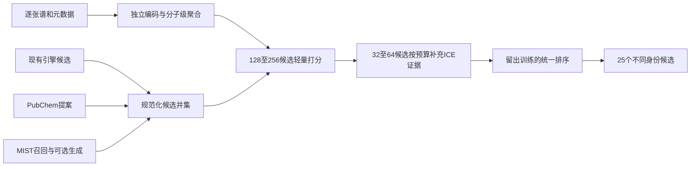

# Enveda CASMI 2026 显著提分的方案与证据

研究日期：2026-11-17。已得分参照：068a public MRR@25 **0.492**，ref `58412029`。本轮完成资料、代码和研究方法审计，尚未执行新模型 GPU 实验。

**优先方向是新版 MIST 候选评分、MSAlign 式谱与结构表示对齐，以及真实多源候选上的学习排序。MS-GPT 可作为有界的候选扩展探索。** 这些方法要共享一个可靠的验证面板：按分子计分、监督结构不交、使用真实检索候选、允许真值不在候选池。此前失败实验不支持“0.492 已到理论上限”，也不足以支持现有一致性门的“零下行”承诺。

## 研究结论发生变化的原因

### 已确认的分数仍是最可靠锚点

| 实验 | 本队公榜 | 能说明什么 |
| --- | --- | --- |
| 068a N-1c LAM 0.35 | 0.492 | 已复现安全底座 |
| 072a DreaMS kNN | 0.492 | 这个库与固定中名次融合没有增益 |
| 073a timsTOF ICE | 0.491 | 这个 top20 小权重重排略降，未否定所有 ICE 用法 |
| 076a DreaMS×Morgan | 0.490 | 这个简化头与融合方式失败，未完整复现 MSAlign |
| 082c 松门 e180 升位 | 0.468 | 该实现严重误升位 |
| 082d 严格 e180 升位 | 0.492 | 该规则无已显示增益；不能单凭同分断定隐藏重叠为零 |
| 082f3 ICE outsider召回 | 0.492 | 21:50新读回中性；只约束这个固定门规则 |

082f3在本轮末已返回0.492；082g、083a尚未返回分数，状态快照见 [progress.md](progress.md)。过去 066/067 的中性结果、CPU 不完整流程与公榜反号、自训替换退步等仍然有效，但只约束实际做过的实现。[既往归档](../../archive/research-archive.md)

### 现有一致性门的精度证据需要重建

本次确认 083a 在 DreaMS 编码前，把同一分子的多个 `[101,2]` 峰序列按数组位置求均值。公开 `preprocess_spectrum` 返回的是 m/z 和强度，并不是嵌入。这会混合不同峰位置、padding 和不同 adduct 的 precursor，不能解释成“每张谱嵌入后取均值”。修正应先逐谱编码，再按与训练一致的规则聚合。

另有尚未排除的监督重叠：对齐头的训练记录使用约 115 万张 Enveda180 嵌入，标定又使用 e180-not-in-train。后者只保证不在**比赛 train**，不保证不在**对齐头训练折**。需要比对实际训练 ID 后才能称为未见结构验证。原始 ICE 面板记录是 3,463 张谱查询，也不能直接当成 3,463 个独立分子。

因此 392/392 的观测精度不能支持隐藏集 100% 精度、独立样本置信区间或零下行。在重新校准前，083a 的分数即使中性，也不能证明正确实现的一致性方法无效；即使上涨，也不能追认原来的泛化证明。详见[历史与验证审计](research/history-and-validation.md)。

### 旧路线排除中有指标混淆

过去用于否定 MIST 的约 10.7% 是完整分子的生成准确率，不是已有候选的检索准确率。新版官方 MIST 的生成、指纹预测、候选检索是不同任务。与此类似，平均五个同式候选上的 ICE R@1，不能和完整管线的隐藏 MRR 直接比较。

旧文中的统一 0.51 盈亏平衡阈值并不成立；正确收益取决于动作覆盖的具体查询、原答案名次与被挤出的答案。已有信号全局较弱，也可能在可识别子集上互补；这种互补必须用同一组查询的真实排序差值来测。

## 推荐路线和优先级

| 优先级 | 方案 | 相对当前方案的新增价值 | 实现条件与主要风险 |
| --- | --- | --- | --- |
| P0 | 正确多谱表示与真实候选验证 | 让后续实验能区分召回、排序和污染；解释083a | 需监督训练ID、来源去重、out-of-fold证据；可先用公开框架搭建，旧1.00精度不沿用 |
| P1 | 官方新版 MIST 做候选评分 | 公开 MSG 权重直接提供另一套谱→概率指纹信号 | 正离子/公式限制；先限定支持范围；核对4096位指纹定义、子公式特征与batch mask |
| P2 | MSAlign 式 DreaMS×MoLFormer | 学习结构语言表示；面向真实候选而非随机小组训练 | 要重新训练匹配的投影头；使用adduct/CE；仍需测天然产物域移 |
| P3 | 多源召回并集与学习排序 | 释放候选截断和固定槽位约束；融合模型的条件互补 | 底座已含多模型，必须证实新增召回/互补；完整流程9h预算 |
| P4 | MS-GPT MSG 候选扩展 | 在已有检索源缺失时生成结构；保留指纹不确定性 | 公式和正离子覆盖、采样成本；必须证明净新命中并能正确排序 |

P1/P2 是最值得投入的模型方向；P3 是把新增信号转换成 MRR 的组织方式，不是一条已证实高分配方。P0 是研究前提，不建设自动化测试体系。

### P1 官方新版 MIST 先用于检索

[coleygroup/MIST](https://github.com/coleygroup/MIST) 已提供 `msg-noaug` 与 `msg-aug` 两条 MSG 配方、公开权重下载入口和训练实现，后者使用 GLACIER 合成增强。主办方已在 [757307 的回复](https://www.kaggle.com/competitions/enveda-CASMI26-molecule-id-mass-spectra/discussion/757307#3553101) 明确允许 MassSpecGym/MIST。这与旧 P0 缺少匹配权重的状态不同。

先让该模型给已有候选打分，减少“生成器是否有效”和“谱编码器是否有效”两种问题的混杂。使用概率指纹，不先强行二值化；在开发折比较 soft Tanimoto、按训练先验校正的位似然和轻量对比评分。指纹必须为匹配 checkpoint 的半径、位长、chirality 配置。

输入公式仅来自观测推断。对质量窗口内多个合理公式，可分别计算公式条件分数，并用独立标定的公式概率组合；不能让候选自己提供任意高置信公式而不支付公式不确定性的代价。真公式只在单独诊断面板中使用，以测公式错误造成的上限损失。

新版代码当前离子列表以正离子为主，缺少本赛负离子通道，timsTOF 也需要检查 instrument 映射。首轮仅对支持的正离子评分，负离子沿用底座；逐分子记录覆盖，避免把输入不支持当成模型没有信息。先比较两个已发布 checkpoint，再决定是否在 timsTOF 上适配。[版本、训练来源和兼容细节](research/frontier-models.md)

### P2 完整对齐框架与多谱条件化

MSAlign 的可借鉴点是冻结谱/分子基础表示、候选级困难负例、CE/adduct 条件以及评分器融合。076a 是 Morgan 2048 小 MLP，不能代表分子语言模型版本。原论文不同切分和不同模型之间的数字只能说明此路线值得测，不能作为本赛预期分。

原版分子塔 MolDeBERTa 的官方条款除 CC-BY-NC-ND 外还有复制、分发与商业衍生限制；不能因为 MSAlign 代码是 MIT 就直接打包。当前可执行替代是 [Apache-2.0 的 MoLFormer](https://huggingface.co/ibm-research/MoLFormer-XL-both-10pct) 加自行训练的对齐头。这个替代必须重训投影，不能沿用 MolDeBERTa 投影参数。[框架与输入核查](research/msalign-and-ranking.md)

多谱先单独编码、再聚合候选分数；对 CE、adduct 与重复谱做显式处理。模型先学习区分同式且被现有检索器排在前列的干扰项，随后再用独立折训练融合。若冻结编码器没有互补性，先止损；有证据后才考虑小范围编码器适配或候选—碎片交叉注意力。

### P3 候选并集到统一 top25

建议执行图如下，具体候选数是起始实验预算，不是固定配方：

这条路线同时回答两个问题：真值是否被来源截断丢掉；进入候选后为何被排错。先保存当前引擎输出中尚未进入25名的候选，测 Recall@25/128/256。若多源并集不增召回，就不继续扩大；若有增召回而最终MRR不动，应把计算转向排序而非再堆结构库。

融合特征可包括基础分数与分差、库命中/类似物可信度、多谱支持、MIST概率指纹、对齐分数、ICE条件分数、质量/加合物一致性及模型分歧。融合在 out-of-fold 候选分数上训练，保留以整组结构为单位的最终验证。可以先用低容量线性/listwise模型或已有树排序技术；优先减少候选和目标错配，不直接上大GNN。

公共 `trnhip/casmi26-e2r-assets` 的模拟框架值得复用：它已提供class1按来源、class2按结构构造查询和重新训练FPNet的脚本。但其query也进入checkpoint选择，且只覆盖Engine2、会过滤掉候选窗内无真值的查询，不能直接当作完整068a未见结构验证。需增加外层untouched结构留出、保留召回失败样本，并补齐其他来源证据。[公开资产核查](research/public-frontier.md)

### P4 MS-GPT 作为候选源

[MS-GPT 当前v2](https://arxiv.org/abs/2607.23607v2) 将概率指纹转换成多组查询再生成结构，已有公开代码/权重；在真实公式已知、每谱100次decoder采样时，MSG结果约为 Top1 10.2%、Top10 13.2%，不是旧版本或搜索摘要中的更高数字。使用MIST-CF预测前5个公式的同版结果为6.83%/8.58%，更接近本赛公式未知的条件；两种口径必须分开。

本赛首先测它是否生成了原候选并集中没有的正确身份，以及每个新增命中的计算成本。若有独立增量，则交给P3的统一排序，让高置信新候选有机会进入前几名。永远只塞23–25名会压低MRR收益，但不应反过来推断生成方法本身无用。

生成/检索共同依赖MIST时，不把两者一致性视为独立证据。公式正确但预测指纹不准、罕见天然产物结构先验弱、采样过度重复，都是合理止损原因。建议先50–100个独立未见结构、固定采样预算；根据去重后的新增真值召回决定是否继续。

### 更高投入的后续训练

若P1证明新谱编码器有信息、但timsTOF域差异限制效果，长期路线是保留MSG预训练起点，用本赛真实timsTOF谱适配逆向模型，再加入合法MSG版GLACIER/ICE生成的天然产物合成谱扩展结构覆盖。训练目标可同时包含概率指纹和真实候选对比，验证只看结构留出的实测谱。

先比较现成checkpoint与小规模真实谱适配，只有后者显示改善才引入合成谱。前向模拟器、公式模型和逆向模型的监督训练曝光都要记入同一清单；模拟谱不能证明真实谱泛化。完整增强训练需要额外GPU预算，不能把论文高端GPU的训练时长当成T4预算。该路线是有前沿框架支撑的中长期投入，不是已经实现的提分方案。[训练资产与分阶段设计](research/frontier-models.md)

## 怎样判断是否可能大幅提分

### 不再从一个公榜分数反推隐藏类别

MRR=0.492 无法唯一确定 rank1率、Recall@25、class1/2/3比例或隐藏库重叠。此前约0.43、0.72及28%零分都是有假设的分解，不能作为硬预算或路线否决依据。

需要三种互补面板：

1. **已见结构的独立谱检索**：按来源/采集批次/谱指纹去重和隔离，回答库检索是否稳健。
2. **监督未见结构、真值可检索**：从所有可控监督阶段去除查询身份，保留结构候选，回答排序能否泛化；对不可审计预训练覆盖单列，不冒充全链无泄漏。
3. **候选缺失与外推结构**：保留真实检索未召回样本，测增量召回；另设更强骨架外推作为压力面板，不把它替代全部部署分布。

开发折负责阈值和融合，最终留出仅用于一次选择确认。多张谱合成一个query分子，按分子汇总MRR与paired bootstrap；同结构的几十张谱不能冒充几十份独立证据。全部SMILES用统一规范化处理，候选顺序随机化，检查不看谱的质量/流行度基线，避免模型学候选来源格式。

### 直接计算动作效用

对每个分子记录旧真值名次 r、新名次 r'，增益就是 `RR(r')−RR(r)`，其中超出25或缺失的RR为0。

- 正确候选从第2升到第1，每个分子增加0.5；从第5升到第1增加0.8。
- 原本正确的首位被挤到第二，损失0.5，而非0.9。
- 永远只填第25名的新命中，每个分子最多增加0.04。

例如目标从0.492到0.520，需要净增0.028。如果只有第2→1的修正而无伤害，需要修正总分子的5.6%；若是第5→1，则为3.5%。这些是所需净效果的算术尺度，**不是预测可实现收益**。实际还要扣除所有伤害和尾部截断损失。

真正值得继续的证据应同时包含：新候选召回增量、同候选条件下MRR增量、实际全流程净MRR、受益与受损分子数、与底座错误重合率、正负离子/质量/谱数/骨架距离分层。全局R@1不是唯一裁判，少数挑选后的阳性例也不是。

## 不列主线的方向

| 方向 | 本次取舍理由 |
| --- | --- |
| 继续扫LAM和固定中名次权重 | 已有多次中性/负结果，未提供新的信息来源 |
| e180/ISDB固定余弦阈值直接升首位 | 当前实现无正向实分，且analog与identity混淆；重启必须有不同机制和独立标定 |
| 原版MolDeBERTa直接打包 | 条款与部署适用性未解决；可用MoLFormer替代框架路线 |
| MSFlow | [作者2026-03-12撤稿](https://arxiv.org/abs/2602.19912)，原因是潜在数据泄漏；旧高分不能支持投入排序 |
| SpecBridge | [作者2026-03-03撤稿](https://arxiv.org/abs/2601.17204)，原因是预处理/评估问题；旧摘要仍可能被检索到 |
| MS-BART、DiffMS、FRIGID完整生成重训 | 有方法研究价值，但在当前预算中，先验证新版谱编码与候选增量更直接；既往FRIGID失败仅约束原实现 |
| CSI:FingerID/MSNovelist NIST权重 | 不进入本赛方案；SIRIUS分子式算法与CSI训练权重须区分，不能混作同一许可/数据判断 |
| 直接从零训练大结构→谱模型 | 当前没有相对迁移学习更强的成本收益证据；小MLP失败不证明这类方法永远无效 |

## 执行与资源决策

具体实验编号与初始预算见 [plan.md](plan.md)。先P0，随后P1和P2共享面板并行比较；P3使用它们产生的真实证据；P4只占有限探索额度。所有完整模型推理在 Kaggle GPU，最终Notebook离线运行；本地只做代码、元数据与轻量审计。

最终9h约束应按完整底座加新增阶段测量，预计算固定结构嵌入和训练产物尽量移出最终推理。运行时按查询不确定性分配昂贵前向/生成预算，始终保留完整合法底座输出作为超时回退；回退发生率必须纳入研究结果，不能默默跳过后仍称同一模型。

决定增加长训练预算的依据，是至少一个新通道在独立面板上显示可复现的净增益与可解释互补，并在完整断网预算内可运行。当前有充分理由开展这些小规模实验；尚无证据承诺0.52或更高公榜。

## 详细证据入口

- [历史实验、MRR算术与验证审计](research/history-and-validation.md)
- [当前公开比赛资产及复现边界](research/public-frontier.md)
- [前沿模型、版本、权重和训练来源](research/frontier-models.md)
- [MSAlign及统一候选排序设计](research/msalign-and-ranking.md)
- [本轮实际核查与状态](progress.md)
